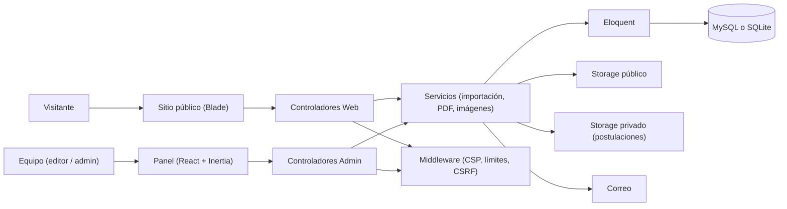
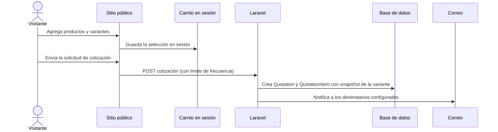
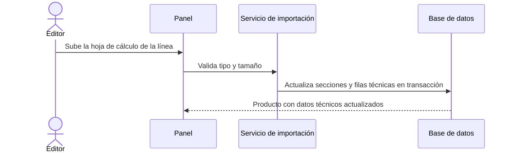
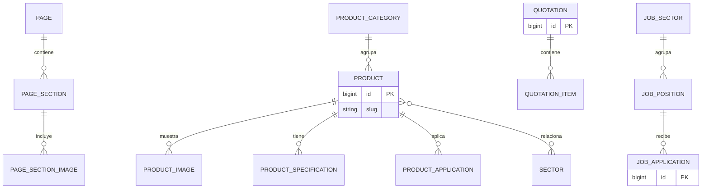

<div align="center">

<br/>

**Sitio corporativo bilingüe y CMS para un catálogo de productos eléctricos industriales.**


</div>


##  Contenido

[El problema](#-el-problema) · [La solución](#-la-solución) · [Funcionalidades](#-funcionalidades) · [Arquitectura](#-arquitectura) · [Flujos de trabajo](#-flujos-de-trabajo) · [Modelo de datos](#-modelo-de-datos) · [Criterios y decisiones](#-criterios-y-decisiones) · [Stack](#-stack) · [Estructura](#-estructura-del-repo) · [Puesta en marcha](#-puesta-en-marcha) · [Pruebas y calidad](#-pruebas-y-calidad) · [Despliegue](#-despliegue) · [Estado y pendientes](#-estado-y-pendientes) · [Licencia y autoría](#-licencia-y-autoría)


##  El problema

La empresa vende productos eléctricos industriales con fichas técnicas, aplicaciones, certificados y líneas de producto que cambian con frecuencia. Publicar o corregir un dato técnico exigía tocar el código, y las cotizaciones y consultas llegaban sin un flujo ordenado ni en los dos idiomas que usan sus clientes.

##  La solución

**Felrro** es una aplicación Laravel con dos caras:

- **Sitio público** en español e inglés, renderizado en servidor con Blade: catálogo por categorías y sectores, fichas de producto, novedades, certificados, descargas y páginas institucionales. Un visitante arma una cotización en un carrito de sesión y la envía.
- **Panel administrativo** con React e Inertia para el equipo administrador: CMS, catálogo, importación de fichas técnicas desde hojas de cálculo, cotizaciones, contactos, newsletter, certificados y recursos humanos.

Los roles son `user`, `editor` y `admin`; el panel exige el rol `admin`.


##  Funcionalidades

**Sitio público** (rol: visitante)
- Sitio corporativo bilingüe con cambio de idioma y respaldo al español cuando falta una traducción.
- Catálogo de productos por categorías y sectores, con buscador, galerías, especificaciones, aplicaciones e iconografía técnica.
- Carrito de cotización en sesión; las solicitudes se guardan y se envían por correo.
- Contacto, newsletter con baja mediante token y postulaciones laborales.

**Panel administrativo** (rol: admin)
- CMS de páginas, secciones y multimedia, con metadatos SEO y Open Graph por página.
- Importación de información técnica desde hojas de cálculo para líneas de producto específicas.
- Generación de fichas técnicas en PDF y administración de los recursos gráficos asociados.
- Gestión de novedades, clientes, certificados, descargas y videos.
- Mensajes de contacto con estado leído/no leído y envío de newsletter.
- Recursos humanos: puestos, sectores y postulaciones; los CV y cartas se guardan en almacenamiento privado.


##  Arquitectura

Monolito modular sobre Laravel. El sitio público entrega HTML desde el servidor con Blade; el panel conserva controladores y reglas en Laravel y usa Inertia para conectarlos con páginas React. Eloquent gestiona la persistencia, y la importación técnica, la generación de PDF y el procesamiento de imágenes viven en servicios de aplicación.

Los archivos públicos se guardan en `storage/app/public`; los documentos de postulantes usan un disco privado.






##  Flujos de trabajo

**Cotización desde el sitio público**



**Importación de ficha técnica**




##  Modelo de datos

Eloquent con migraciones relacionales (56 migraciones y 28 modelos en el repositorio). Los campos traducibles se guardan como JSON con claves de idioma.



`Product` usa borrado lógico. Las importaciones técnicas y las operaciones que combinan base de datos y archivos usan transacciones.


##  Criterios y decisiones

- **Contenido traducible en el mismo registro.** Español e inglés conviven en una sola entidad, y el respaldo al español se resuelve en helpers del modelo.
- **Documentos privados.** CV y cartas nunca quedan en el disco público; se descargan solo por rutas administrativas protegidas.
- **Snapshot de la variante cotizada.** Cada `QuotationItem` conserva el estado de la variante al momento de la solicitud.
- **Lógica pesada fuera de los controladores.** Importadores y generadores de PDF son servicios; los controladores solo orquestan.

| Decisión | Por qué |
| --- | --- |
| Blade para lo público y React/Inertia para el panel | HTML servido desde el servidor para el sitio, y una experiencia interactiva para el equipo, sin una API separada. |
| CMS con página, sección y multimedia como entidades | Cada bloque se ordena y edita sin depender de una página rígida. |
| Borrado lógico en productos | Permite recuperar un producto retirado del catálogo público. |


##  Stack

| Capa | Tecnología | Versión |
| --- | --- | --- |
| Lenguaje | PHP | ^8.2 |
| Backend | Laravel framework | ^12.0 (lock 12.59.0) |
| Integración panel | inertiajs/inertia-laravel | 2.0.24 |
| API y sesiones | Laravel Sanctum | 4.3.2 |
| Frontend | React | 18.3.1 |
| Frontend | @inertiajs/react | 2.3.23 |
| Estilos | Tailwind CSS | 4.3.0 |
| Build | Vite | 7.3.6 |
| Pruebas | PHPUnit | según `composer.json` |
| Base de datos | MySQL o SQLite según `DB_CONNECTION` | — |


##  Estructura del repo

```text
app/Http/Controllers/         sitio público y panel
app/Services/                 importación técnica, PDF e imágenes
app/Models/                   entidades Eloquent (28)
database/migrations/          esquema relacional (56)
resources/views/              Blade público
resources/js/                 panel React e Inertia
routes/web.php, admin.php     rutas públicas y del panel
routes/auth.php               autenticación
docs/                         guía de carga masiva de productos (PDF)
tests/                        pruebas de autenticación y de funcionalidad
```


##  Puesta en marcha

Requisitos: PHP 8.2+, Composer, Node.js y npm compatibles con el lockfile, y MySQL si se usa esa conexión.

```bash
composer install
npm ci
cp .env.example .env              # configurar base, correo y variables localmente
php artisan key:generate
php artisan migrate
php artisan db:seed               # contenido inicial, opcional
php artisan storage:link
composer run dev                  # servidor, cola, logs y Vite en paralelo
```

Variables relevantes (por nombre): `DB_*`, `MAIL_*`, `QUEUE_CONNECTION`, `APP_URL`. No reutilizar credenciales de producción en local.


##  Pruebas y calidad

Pruebas de autenticación: inicio y cierre de sesión, registro, verificación de correo, confirmación y actualización de contraseña, y recuperación. Usan SQLite en memoria.

```bash
composer test
vendor/bin/pint --test
npm run build
```

La cifra registrada en la versión anterior de este README fue de 18 pruebas y 38 aserciones aprobadas; no se volvió a ejecutar para este cambio. No hay pruebas E2E, de carga ni cobertura automatizada de los módulos de negocio.


##  Despliegue

No documentado en el repositorio. No hay infraestructura como código, receta de despliegue, Dockerfile ni pipeline de CI/CD. Proveedor, servidor web y estrategia de copias de seguridad no se pueden verificar desde el código.


##  Estado y pendientes

- **Estado:** aplicación funcional con sitio bilingüe, CMS, catálogo, cotizaciones, newsletter, RR. HH. y panel.
- **Último commit:** 2026-06-29, `VERSION 1.1.8`, en el historial local.
- **Producción:** no verificado.
- **Pendientes:** pruebas para los módulos de negocio; documentar el despliegue.


##  Licencia y autoría

Desarrollado por el **Ing. Santiago Abasto**.


Repositorio sin archivo de licencia. El código y el contenido son propiedad del cliente, Felrro, salvo que se acuerde otra cosa.
